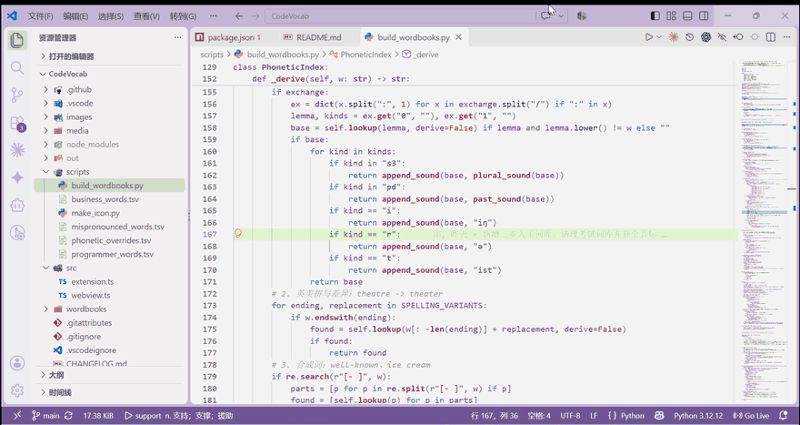

<p align="center">
  
</p>

<h1 align="center">CodeVocab · 码上背单词</h1>

<p align="center">
  写代码的时候顺便背单词：后台朗读单词和中文释义，状态栏同步显示词性和意思。<br>
  专为程序员准备了编程词汇和易读错词，也内置商务英语和四六级、考研、雅思、托福、GRE 等考试词库。
</p>

<p align="center">
  <a href="https://marketplace.visualstudio.com/items?itemName=Miaoo.codevocab"></a>
  <a href="https://marketplace.visualstudio.com/items?itemName=Miaoo.codevocab"></a>
  <a href="https://github.com/wjt2018/codevocab/actions/workflows/ci.yml"></a>
  <a href="https://github.com/wjt2018/codevocab/blob/main/LICENSE"></a>
</p>

<p align="center">
  
</p>

## ✨ 功能

**听和看**

- 🔊 **边写代码边听**：先读英文单词，再读中文释义。使用系统自带语音，不需要联网，也不需要账号。
- 📌 **状态栏同步显示**：读到哪个词，底部状态栏就显示哪个词的词性和释义；鼠标悬停可以看到音标和完整释义。
- 🔇 **静音模式**：不方便出声的时候，单词照常在状态栏轮播。
- 🙈 **一键隐藏**：开会、共享屏幕时，一个快捷键把状态栏上的单词藏起来。

**词库**

- 💻 **程序员词汇**（默认）：近 700 个读技术文档、写代码时最常见的词，释义按编程语境整理（commit 是“提交”，不是“犯罪”）。
- 🗣️ **程序员易读错词**：Linux、Nginx、cache、height、Gemini……一百多个常被读错的词，附正确音标和常见误读说明。
- 💼 **商务英语**：近 500 个职场常用词，覆盖财务、营销、合同、会议、商务邮件等场景。
- 📚 **8 本考试词库**：四级、六级、考研、雅思、托福、GRE、高考、中考，已去掉 in、go、make 这类过于基础的词。
- 📂 **导入自己的单词本**：支持 JSON、CSV、TSV、TXT。

**控制**

- 🎯 **从任意位置开始**：按单词、中文意思、序号或百分比跳转。
- 🖱️ **鼠标或快捷键都能操作**：发音面板里有播放、切换、跳转、换词库的按钮。
- 💾 **记住进度**：每本单词本的进度分开保存，重启 VS Code 后接着上次的位置听。

## 🚀 快速开始

1. 在 VS Code 扩展面板搜索 **CodeVocab** 并安装。
2. 按 `Ctrl+Alt+P`（macOS 上是 `Cmd+Alt+P`）开始播放。
3. 第一次播放时，底部会打开「CodeVocab」发音面板，用来发出声音。开始播放后可以收起这个面板，不影响发音。

默认播放程序员词汇。想换词库，在发音面板顶部的下拉框里选，或者运行命令 `CodeVocab: 选择单词本…`。

## 🎛️ 发音面板

按 `Ctrl+J` 打开底部面板，再点「CodeVocab」标签，就能看到发音面板：

| 区域 | 作用 |
|---|---|
| 单词本下拉框 | 切换内置词库，或从文件导入 |
| 当前单词 | 单词、音标和完整释义 |
| 控制按钮 | 上一个、播放/暂停、下一个、静音、显示/隐藏状态栏 |
| 进度条 | 拖动选择从第几个词开始 |
| 跳转输入框 | 输入序号、百分比或单词后按回车；「搜索…」按钮可以按单词或中文意思查找 |
| 语音检测 | 显示系统里找到的英文和中文语音，没有声音时先看这里 |

面板收起后，朗读和状态栏轮播会照常进行。

## ⌨️ 快捷键

| 功能 | Windows / Linux | macOS |
|---|---|---|
| 播放 / 暂停 | `Ctrl+Alt+P` | `Cmd+Alt+P` |
| 静音 / 取消静音 | `Ctrl+Alt+M` | `Cmd+Alt+M` |
| 显示 / 隐藏状态栏单词 | `Ctrl+Alt+H` | `Cmd+Alt+H` |
| 上一个单词 | `Ctrl+Alt+[` | `Cmd+Alt+[` |
| 下一个单词 | `Ctrl+Alt+]` | `Cmd+Alt+]` |
| 跳转到单词 | `Ctrl+Alt+G` | `Cmd+Alt+G` |

点击状态栏上的单词也可以播放或暂停。所有快捷键都可以在「键盘快捷方式」（`Ctrl+K Ctrl+S`）中搜索 `codevocab` 修改。

## 🎯 从指定位置开始听

按 `Ctrl+Alt+G`，或在发音面板的输入框里输入：

| 输入 | 效果 |
|---|---|
| `abandon` 或 `放弃` | 按单词或中文意思搜索 |
| `500` | 跳到第 500 个单词 |
| `50%` | 跳到单词本的一半 |

也可以直接拖动发音面板里的进度条。正在播放时，跳过去就从那个词接着读。

## 📚 内置词库

| 词库 | 词数 | 排序 | 特点 |
|---|---|---|---|
| 💻 程序员词汇（默认） | 687 | 词频 | 释义按编程语境整理，悬停可对照通用释义 |
| 🗣️ 程序员易读错词 | 109 | 主题 | 人工标注音标，附常见误读说明 |
| 💼 商务英语 | 495 | 词频 | 释义按商务语境整理 |
| 大学英语四级 | 3620 | 词频 | |
| 大学英语六级 | 5223 | 词频 | |
| 考研 | 4595 | 词频 | |
| 雅思 IELTS | 4689 | 词频 | |
| 托福 TOEFL | 6861 | 词频 | |
| GRE | 7455 | 词频 | |
| 高考 | 2884 | 词频 | |
| 中考 | 848 | 词频 | |

按词频排序的词库，常用词排在前面。状态栏显示简短释义，完整释义在悬停提示和发音面板里。

### 💻 程序员词汇

覆盖 16 个主题：基础概念、数据类型、语句与表达式、函数与面向对象、数据结构与算法、错误与调试、测试与质量、版本控制、构建部署、系统与并发、网络与 Web、数据库、安全、界面与交互、性能与架构，以及读文档时常见的词（optional、explicit、deprecated、caveat……）。

状态栏显示编程语境下的意思，悬停时可以对照通用释义：

```
thread  /θred/
【编程】n. 线程
n. 线；丝；纤维；线索
```

### 🗣️ 程序员易读错词

收录产品名（Gemini、Nginx、Kubernetes、Vue、Django）、缩写（SQL、JSON、YAML、GUI）和常被读错的普通单词（cache、height、width、suite、schema）：

```
Linux  /ˈlɪnəks/
【读音】n. 开源操作系统
⚠ 常见误读：不读“来纳克斯” /ˈlaɪnəks/；创始人 Linus 本人读 /ˈlɪnəks/
```

- 有多种公认读法的词（如 SQL、GIF、sudo）会注明几种都可以。
- 系统语音直接读 Nginx、C#、Qt 这类词容易读错，所以这些词会改为朗读 `engine x`、`C sharp`、`cute`。
- 建议打开设置 `codevocab.showPhonetic`，在状态栏直接显示音标。

### 💼 商务英语

覆盖公司与组织、人力资源、财务会计、银行投资、经济、市场营销、销售与客户、贸易物流、合同法务、会议谈判、项目管理和商务邮件，释义按商务语境整理（比如 turnover 是“营业额；人员流动率”，breach 是“违约”）。

### 📚 考试词库

根据 ECDICT 的考试标签生成，并做了这些处理：

- **去掉过于基础的词**：中考词汇中词频最高的约 700 个词（the、in、go、make、good……），以及月份、星期、国名等首字母大写的词。
- **补全音标**：ECDICT 缺音标的词，从词根推导（如 planning 由 plan 推出），推导不出的人工补充。现在所有词都有音标。
- **修正数据错误**：如拼写错误的 reservior 改为 reservoir，排除人名等误收录的词条。

## 📂 导入自己的单词本

在发音面板的下拉框里选「从文件导入…」，或者运行 `CodeVocab: 选择单词本…` → 「从文件导入…」。

**JSON**（只有 `word` 和 `meaning` 是必填的）

```json
[
  {
    "word": "abandon",
    "phonetic": "/əˈbændən/",
    "pos": "v.",
    "meaning": "放弃；抛弃",
    "detail": "vt. 放弃；抛弃；遗弃\nn. 放任；无拘束"
  },
  {
    "word": "Nginx",
    "phonetic": "/ˌendʒɪnˈeks/",
    "meaning": "高性能网页服务器",
    "speak": "engine x"
  }
]
```

| 字段 | 必填 | 说明 |
|---|---|---|
| `word` | ✅ | 单词 |
| `meaning` | ✅ | 简短释义，显示在状态栏并朗读 |
| `phonetic` | | 音标 |
| `pos` | | 词性 |
| `detail` | | 完整释义，可以用 `\n` 换行，显示在悬停提示和发音面板 |
| `speak` | | 朗读文本：系统语音读错单词时，用这段文本代替单词朗读 |

**CSV / TSV / TXT**（每行一个词，`#` 开头的行是注释；只支持单词、词性、释义三列）

```
# 单词,词性,释义
abandon,v.,放弃；抛弃
ability,n.,能力
# 也可以省略词性
hello,你好
```

## ⚙️ 设置

| 设置项 | 默认值 | 说明 |
|---|---|---|
| `codevocab.builtinWordbook` | `programmer` | 内置词库 |
| `codevocab.wordbookPath` | 空 | 自定义单词本路径，填写后优先于内置词库 |
| `codevocab.interval` | `2000` | 读完一个词后，间隔多少毫秒播下一个 |
| `codevocab.mutedDuration` | `5000` | 静音时每个词停留多少毫秒 |
| `codevocab.speakMeaning` | `true` | 是否朗读中文释义 |
| `codevocab.rate` | `0.9` | 朗读语速，1 为正常速度 |
| `codevocab.maxMeaningLength` | `30` | 状态栏里释义最多显示多少个字符 |
| `codevocab.showPhonetic` | `false` | 在状态栏中显示音标 |

## ❓ 常见问题

**没有声音，或者中文读不出来？**
打开底部「CodeVocab」发音面板，看看检测到的英文语音和中文语音。如果显示“未找到”，需要在系统里安装对应的语音包：

- **Windows**：设置 → 时间和语言 → 语音 → 添加语音
- **macOS**：系统设置 → 辅助功能 → 朗读内容 → 系统声音 → 管理声音
- **Linux**：取决于发行版和桌面环境，部分系统没有可用的语音

**提示“发音被拦截”？**
点击发音面板里的「播放」按钮即可。

**声音听起来比较机械？**
CodeVocab 使用的是操作系统自带的语音，音质取决于系统。Windows 11 和 macOS 上的“自然”或“增强”语音效果会好很多，可以在系统设置里下载。

**某个词读得不对？**
系统语音偶尔会读错专有名词。自己的单词本可以用 `speak` 字段指定朗读文本；内置词库的问题欢迎[提 Issue](https://github.com/wjt2018/codevocab/issues)。

**状态栏太挤？**
调小 `codevocab.maxMeaningLength`，或者用 `Ctrl+Alt+H` 暂时隐藏。

**想只看不听？**
按 `Ctrl+Alt+M` 打开静音，单词照常在状态栏轮播。如果只想听英文不听中文，关掉 `codevocab.speakMeaning`。

**会上传我的数据吗？**
不会。CodeVocab 不联网，不收集任何数据。播放进度只保存在本机的 VS Code 里。

## 🤝 参与贡献

欢迎提交 Issue 和 Pull Request！开发环境、词库生成方法和发布流程见 [CONTRIBUTING.md](CONTRIBUTING.md)。

- 🐛 [反馈问题](https://github.com/wjt2018/codevocab/issues)
- 📝 发现释义、音标不准，或者想补充程序员词汇、易读错词，可以直接修改 `scripts/` 下对应的词表并提交 Pull Request
- 💡 有想要的功能或词库，也欢迎在 Issue 里提出

## 🙏 致谢

考试词库的数据，以及程序员词汇、商务英语的部分音标和通用释义，来自 [ECDICT](https://github.com/skywind3000/ECDICT)（MIT License，许可证见 [wordbooks/ECDICT-LICENSE.txt](wordbooks/ECDICT-LICENSE.txt)），由 [scripts/build_wordbooks.py](scripts/build_wordbooks.py) 转换生成。感谢 ECDICT 的作者和贡献者。

程序员词汇、商务英语和程序员易读错词的词条、释义和读音说明由本项目人工整理，与项目代码一样采用 MIT 协议。

<!-- github-only:start（打包时由 scripts/marketplace-readme.js 去掉，不出现在插件商店） -->
感谢 [LINUX DO](https://linux.do) 社区。
<!-- github-only:end -->

## 📄 License

[MIT](LICENSE)

---

## English

**CodeVocab** reads vocabulary words and their Chinese meanings aloud while you code, and shows the current word, part of speech and meaning in the status bar.

- **Built for developers**: a curated programmer vocabulary (~700 words, with meanings in a programming context), plus a list of ~100 tech words Chinese developers commonly mispronounce (Linux, Nginx, cache, Gemini…) with IPA and notes.
- **More word lists**: business English (~500 words) and exam lists for CET-4, CET-6, Kaoyan, IELTS, TOEFL, GRE, Gaokao and Zhongkao, generated from [ECDICT](https://github.com/skywind3000/ECDICT). Custom JSON / CSV word lists are supported too.
- **Stays out of your way**: mute mode, one-key hide, jump to any word, and a panel with mouse controls.
- **Private and offline**: speech uses your operating system's built-in voices; no network access and no data collection.

Shortcuts: `Ctrl+Alt+P` play/pause · `Ctrl+Alt+M` mute · `Ctrl+Alt+H` show/hide · `Ctrl+Alt+[` / `]` previous/next · `Ctrl+Alt+G` jump to word.
