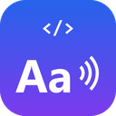

<p align="center">
  
</p>

<h1 align="center">CodeVocab · 码上背单词</h1>

<p align="center">
  写代码的时候顺便背单词：后台朗读单词和中文释义，状态栏同步显示词性和意思。
</p>

<p align="center">
  <a href="https://marketplace.visualstudio.com/items?itemName=Miaoo.codevocab"></a>
  <a href="https://marketplace.visualstudio.com/items?itemName=Miaoo.codevocab"></a>
  <a href="https://github.com/wjt2018/codevocab/blob/main/LICENSE"></a>
</p>

<!--
  截图：在 VS Code 里截好图后放到 images/ 目录，再去掉这段注释。
  插件商店不支持 SVG 图片，请用 PNG 或 GIF。
  
  
-->

## ✨ 功能

- 🔊 **边写代码边听**：先读英文单词，再读中文释义。使用系统自带语音，不需要联网，也不需要账号。
- 📌 **状态栏同步显示**：读到哪个词，底部状态栏就显示哪个词的词性和释义；鼠标悬停可以看到音标和完整释义。
- 📚 **内置 8 本考试词库**：四级、六级、考研、雅思、托福、GRE、高考、中考，也可以导入自己的单词本。
- 🎯 **从任意位置开始**：按单词、中文意思、序号或百分比跳转，不用每次都从 abandon 开始。
- 🔇 **静音模式**：不方便出声的时候，单词照常在状态栏轮播。
- 🙈 **一键隐藏**：开会、共享屏幕时，一个快捷键把状态栏上的单词藏起来。
- 💾 **记住进度**：每本单词本的进度分开保存，重启 VS Code 后接着上次的位置听。

## 🚀 快速开始

1. 在 VS Code 扩展面板搜索 **CodeVocab** 并安装。
2. 按 `Ctrl+Alt+P`（macOS 上是 `Cmd+Alt+P`）开始播放。
3. 第一次播放时，底部会打开「CodeVocab」发音面板，用来发出声音。开始播放后可以收起这个面板，不影响发音。

默认播放四级词库。想换词库，运行命令 `CodeVocab: 选择单词本…`。

## ⌨️ 快捷键

| 功能 | Windows / Linux | macOS |
|---|---|---|
| 播放 / 暂停 | `Ctrl+Alt+P` | `Cmd+Alt+P` |
| 静音 / 取消静音 | `Ctrl+Alt+M` | `Cmd+Alt+M` |
| 显示 / 隐藏状态栏单词 | `Ctrl+Alt+H` | `Cmd+Alt+H` |
| 上一个单词 | `Ctrl+Alt+[` | `Cmd+Alt+[` |
| 下一个单词 | `Ctrl+Alt+]` | `Cmd+Alt+]` |
| 跳转到单词 | `Ctrl+Alt+G` | `Cmd+Alt+G` |

不想用快捷键的话，可以点击状态栏上的单词来播放或暂停，或者用底部「CodeVocab」发音面板里的按钮操作。打开面板的方法：按 `Ctrl+J` 打开底部面板，再点「CodeVocab」标签。

所有快捷键都可以在「键盘快捷方式」（`Ctrl+K Ctrl+S`）中搜索 `codevocab` 修改。

## 🎯 从指定位置开始听

按 `Ctrl+Alt+G`，或在发音面板的输入框里输入：

| 输入 | 效果 |
|---|---|
| `abandon` 或 `放弃` | 按单词或中文意思搜索 |
| `500` | 跳到第 500 个单词 |
| `50%` | 跳到单词本的一半 |

也可以直接拖动发音面板里的进度条。正在播放时，跳过去就从那个词接着读。

## 📚 单词本

### 内置词库

| 词库 | 词数 |
|---|---|
| 大学英语四级 | 3849 |
| 大学英语六级 | 5407 |
| 考研 | 4801 |
| 雅思 IELTS | 5040 |
| 托福 TOEFL | 6974 |
| GRE | 7503 |
| 高考 | 3677 |
| 中考 | 1603 |

内置词库按词频排序，常用词在前面。状态栏显示简短释义（最常见词性的前几个义项），完整释义在悬停提示和发音面板里。

### 导入自己的单词本

运行 `CodeVocab: 选择单词本…` → 「从文件导入…」，支持以下格式：

**JSON**（只有 `word` 和 `meaning` 是必填的）

```json
[
  {
    "word": "abandon",
    "phonetic": "/əˈbændən/",
    "pos": "v.",
    "meaning": "放弃；抛弃",
    "detail": "vt. 放弃；抛弃；遗弃\nn. 放任；无拘束"
  }
]
```

**CSV / TSV / TXT**（每行一个词，`#` 开头的行是注释）

```
# 单词,词性,释义
abandon,v.,放弃；抛弃
ability,n.,能力
# 也可以省略词性
hello,你好
```

## ⚙️ 设置

| 设置项 | 默认值 | 说明 |
|---|---|---|
| `codevocab.builtinWordbook` | `cet4` | 内置词库 |
| `codevocab.wordbookPath` | 空 | 自定义单词本路径，填写后优先于内置词库 |
| `codevocab.interval` | `2000` | 读完一个词后，间隔多少毫秒播下一个 |
| `codevocab.mutedDuration` | `5000` | 静音时每个词停留多少毫秒 |
| `codevocab.speakMeaning` | `true` | 是否朗读中文释义 |
| `codevocab.rate` | `0.9` | 朗读语速，1 为正常速度 |
| `codevocab.maxMeaningLength` | `30` | 状态栏里释义最多显示多少个字符 |

## ❓ 常见问题

**没有声音，或者中文读不出来？**
打开底部「CodeVocab」发音面板，看看检测到的英文语音和中文语音。如果显示“未找到”，需要在系统里安装对应的语音包：

- **Windows**：设置 → 时间和语言 → 语音 → 添加语音
- **macOS**：系统设置 → 辅助功能 → 朗读内容 → 系统声音 → 管理声音
- **Linux**：取决于发行版和桌面环境，部分系统没有可用的语音

**提示“发音被拦截”？**
点击发音面板里的「播放」或「启用发音并播放」按钮即可。

**声音听起来比较机械？**
CodeVocab 使用的是操作系统自带的语音，音质取决于系统。Windows 11 和 macOS 上的“自然”或“增强”语音效果会好很多，可以在系统设置里下载。

**会上传我的数据吗？**
不会。CodeVocab 不联网，不收集任何数据。播放进度只保存在本机的 VS Code 里。

## 🤝 参与贡献

欢迎提交 Issue 和 Pull Request！开发环境搭建、项目结构和发布流程见 [CONTRIBUTING.md](CONTRIBUTING.md)。

- 🐛 [反馈问题](https://github.com/wjt2018/codevocab/issues)
- 💡 有想要的功能或词库，也欢迎在 Issue 里提出

## 🙏 致谢

内置词库的数据来自 [ECDICT](https://github.com/skywind3000/ECDICT)（MIT License，许可证见 [wordbooks/ECDICT-LICENSE.txt](wordbooks/ECDICT-LICENSE.txt)），由 [scripts/build_wordbooks.py](scripts/build_wordbooks.py) 转换生成。感谢 ECDICT 的作者和贡献者。

## 📄 License

[MIT](LICENSE)

---

## English

**CodeVocab** reads vocabulary words and their Chinese meanings aloud while you code, and shows the current word, part of speech and meaning in the status bar. It ships with word lists for CET-4, CET-6, Kaoyan, IELTS, TOEFL, GRE, Gaokao and Zhongkao (generated from [ECDICT](https://github.com/skywind3000/ECDICT)), and supports custom JSON / CSV word lists. Speech uses your operating system's built-in voices, so it works offline and collects no data.

Shortcuts: `Ctrl+Alt+P` play/pause · `Ctrl+Alt+M` mute · `Ctrl+Alt+H` show/hide · `Ctrl+Alt+[` / `]` previous/next · `Ctrl+Alt+G` jump to word.
