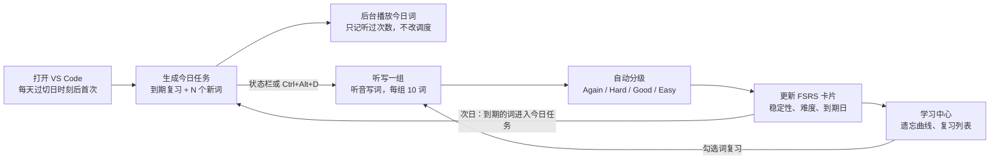

# CodeVocab 每日任务与听写复习 · 设计文档

- 版本：0.4.0 – 0.6.0
- 日期：2026-11-26
- 状态：已定稿（在线文档为讨论稿，此文件为存档）
- 相关决策：[ADR 0001](../adr/0001-use-fsrs-for-review-scheduling.md) · [ADR 0002](../adr/0002-card-key-is-lowercase-word.md) · [ADR 0003](../adr/0003-dictation-is-the-only-scheduling-signal.md) · [ADR 0004](../adr/0004-split-storage-globalstate-and-log-files.md) · [ADR 0005](../adr/0005-bundle-with-esbuild.md) · [ADR 0006](../adr/0006-study-center-as-editor-webview-panel.md)

## 背景与目标

CodeVocab 0.3.0 只有被动输入：后台朗读、状态栏轮播。单词听过就过去了，没有检验，也没有复习安排，实际记住的很少。

本次要补上“每日任务 → 听写检验 → 按遗忘规律复习”这个闭环：

- **每日任务**：从选定的单词本里每天抽出固定数量的词，默认播放的就是这批词。
- **听写**：对今日的词和到期的词做听写，结果自动分级记录。
- **复习曲线**：根据听写记录给每个词排复习时间，画出遗忘曲线和待复习量。用户可以挑词复习，复习时的听写结果会刷新曲线。
- **趣味性**：在不做账号体系的前提下，用自我对比、程序员风格的反馈和代码场景提高坚持率。

**这次不做**：账号体系、在线排行榜、云端同步服务、自定义 TTS 音源。

## 核心用户流程



听写是唯一更新复习数据的环节，结果回流到第二天的任务。播放让用户对词有印象，听写才检验是否记住，并把结果写进 FSRS。到期的词第二天回到今日任务；用户也可以随时在学习中心挑词复习。

## 每日任务

今日任务 = 到期复习词 + N 个新词。只给新词会让复习越积越多，所以复习优先，新词数量根据复习量自动收缩。

### 生成规则

1. 触发时机：插件激活时或每次播放前，发现已存计划的日期不是今天，就重新生成。“今天”按本地时区，凌晨 4 点切日（可配置），照顾熬夜的程序员。
2. 复习部分：取所有 `due <= 今日切日时刻` 的词，按当前记忆保持率 R 从低到高排序，最多取“每日复习上限”个（默认 100）。
3. 新词部分：新词数 = `min(每日新词数, max(0, 每日总量上限 - 复习数))`。从任务单词本里未学过的词中抽取。
4. 抽取方式：默认随机，可选“按词库顺序”。随机用 `日期 + 词库 id` 做种子，同一天重启 VS Code 抽到的是同一批。
5. 生成后存为 `{ date, wordbookId, newIds, reviewIds }`，当天不再变。当天中途改了设置，提示“明天生效”，或者用命令手动重新生成。
6. 用户可以用“再来 10 个”追加新词，追加的词并入当天计划。

复习词不限于任务单词本：切换过词库的用户，旧词库里到期的词也会进入今日复习。

「程序员易读错词」词库暂时只能播放：不能选作每日任务单词本，不进听写，也不生成复习卡片和曲线。

### 播放行为

- 开启每日任务后，“播放”默认在今日任务词里循环，新词在前、复习词在后。发音面板上有开关，可以切回“整本词库”模式。
- 播放只累计“听过次数”，不影响复习调度：听过不代表记住了。
- 未开启每日任务时，行为和 0.3.0 完全一致。

### 默认值

| 配置 | 默认 | 说明 |
| --- | --- | --- |
| 每日新词数 | 20 | 0 = 只复习 |
| 每日复习上限 | 100 | 超出的顺延到明天 |
| 每日总量上限 | 120 | 复习多时自动少给新词 |
| 抽取方式 | 随机 | 可选“按顺序” |
| 切日时刻 | 04:00 | 本地时间 |

## 听写

听写是唯一会写入复习数据的环节。它做成一组 3–5 分钟的专门练习，不和写代码同时进行。

### 一组听写

- 来源：今日任务（默认）、复习列表里勾选的词、或当前播放的这个词。
- 每组默认 10 词，可以中途退出。已答的题当场生效，没答的不计分。
- 一组里答错的词，在本组末尾再考一次。第二次只用来巩固，不再改变评分。

### 题型

| 题型 | 给出 | 作答 | 适用 |
| --- | --- | --- | --- |
| 听音写词（主题型） | 发音 + 中文释义 | 键入英文 | 默认 |
| 看中文写英文 | 中文释义 + 词性 | 键入英文 | 静音模式、没有英文语音时 |
| 听音选义 | 发音 | 四选一 | 第一次接触的新词（可选） |

听音写词一定同时显示中文释义，用来区分 right/write、their/there 这类同音词。可以按快捷键重播，或慢速播放。

### 自动分级

用户不自己打分，按作答行为判定，直接对应 FSRS 的四个评分：

| 作答情况 | 等级 | FSRS 评分 |
| --- | --- | --- |
| 一次写对，用时 ≤ 快速阈值 | 简单 | Easy |
| 一次写对 | 良好 | Good |
| 看提示后写对，或修改 1 次后写对 | 困难 | Hard |
| 写错、跳过、重试后仍错 | 忘记 | Again |

- 快速阈值：`2 秒 + 0.4 秒 × 字母数`，从发音结束开始计时。初始值拍脑门定的，上线后用本地数据校准。
- 提示分两档：第一档显示字母数和首字母，第二档显示一半字母。用了任一档提示，最高只能评 Hard。
- 「我不会」按钮等同跳过，评 Again，然后直接显示答案。

### 判定规则

- 忽略大小写和首尾空格。词组里的多个空格合并成一个。
- 词组和带符号的词：连字符和空格互相算对，比如 `log in`、`log-in` 都对。
- 英美拼写都算对：color/colour、organize/organise。词库新增可选的 `variants` 字段，由 `scripts/build_wordbooks.py` 打包时生成。
- 同一个词条下的其他形式不算对，比如答案是 analysis 却写成 analyses。但反馈里会提示“是它的复数形式”。

### 错误展示

写错时做字符级 diff：用户多写的字母划线，漏写的字母高亮，比如 rec**ie**ve → rec**ei**ve。同时显示音标和释义，再播一遍发音。错词会记录下来，之后用于“易错词”统计。

## 复习调度

采用 FSRS 算法，直接用开源库 `ts-fsrs`（MIT 协议，纯 TS，没有运行时依赖）。不用固定间隔表，因为固定间隔不区分答得好和答得差，也画不出真实的遗忘曲线。

### 每个词的状态

FSRS 给每个词维护一张卡片，关键字段：

- **稳定性 S**（天）：记忆保持率从 100% 降到 90% 所需的时间。答得越好，S 涨得越多。
- **难度 D**（1–10）：这个词对这个用户有多难，影响 S 的增长速度。
- **due**：下次应复习的时间。
- **状态**：New / Learning / Review / Relearning，以及复习次数 reps 和遗忘次数 lapses。

任意时刻的记忆保持率 R 由 S 和距上次复习的天数 t 算出。FSRS-5 的公式如下，实际以所选 `ts-fsrs` 版本自带的函数为准：

```latex
R(t, S) = \left(1 + \frac{19}{81} \cdot \frac{t}{S}\right)^{-0.5}
```

### 更新时机

| 事件 | 是否更新 FSRS |
| --- | --- |
| 听写作答（任何题型） | 是，按上一节的评分映射 |
| 一组内答错后的重考 | 否 |
| 后台播放、状态栏轮播 | 否，只记“听过次数” |
| 手动标记“太简单，不再复习” | 不走 FSRS，直接标为已排除 |

听音选义是选择题，比拼写容易得多。它答对时最高只评 Good，避免 S 涨得虚高。

### 参数

- 目标保持率 `request_retention`：默认 0.9，配置项允许 0.8–0.95。越高复习越频繁。
- 最大间隔：默认 365 天。
- 开启间隔随机抖动（fuzz），避免同一天学的词之后每次都在同一天到期。
- 权重用库的默认值。以后可以用用户自己的作答日志训练个性化权重，这次不做，但会保留完整日志。

### 与状态栏单词的关系

开了每日任务时，状态栏按今日任务轮播；没开时，按词库顺序轮播。状态栏还会常驻一个任务入口，详见「界面与交互」。

## 复习曲线与可视化

可视化放在一个新的编辑器标签页「CodeVocab 学习中心」里，分四个视图。所有图都从本地数据实时算出来，不单独存图表数据。

### 1. 今日概览（首页）

- 三个数字：今日新词完成数、今日复习完成数、连续打卡天数。
- 一个大按钮「开始听写」。
- 下方显示最近一次听写的结果摘要。

### 2. 未来待复习量

未来 14 天每天到期的词数，柱状图。柱子分两色：第一次复习的新词、稳定复习的老词。用户看一眼就知道哪天会堆积。

### 3. 单词遗忘曲线

横轴是时间，纵轴是记忆保持率 R。

- 每次听写是一个点，颜色表示评分。点与点之间是按当时的 S 算出的下降曲线，听写后跳回接近 100%。
- 今天之后的部分用虚线延伸，并标出下次到期日。
- 90% 目标线画成一条水平参考线。
- 入口：复习列表里点某个词，或在发音面板里点当前词的「曲线」按钮。

这张图的目的是让用户看见“复习有用”：答对一次，曲线就变得更平缓。

### 4. 复习列表

一张表，每个学过的词一行：单词、当前 R、下次到期、复习次数、错误次数、来源词库。

- 默认按 R 从低到高排，最危险的在最上面。
- 筛选：已到期 / 易错词（lapses ≥ 2）/ 按词库 / 搜索。
- 勾选任意词 →「听写所选」。不到期的词也能提前复习，FSRS 会按实际间隔处理。
- 听写结束后回到列表，刚听写过的词的 R 和到期日已经刷新。

### 5. 打卡热力图（阶段二）

类似 GitHub contribution 的格子图，最近 52 周，每格一天，颜色深浅表示当天听写词数。

### 图表实现

webview 里用手写 SVG 画，不引入 ECharts 之类的大库，保持插件体积小。颜色取 VS Code 主题变量（`--vscode-charts-*`），浅色和深色主题都能自动适配。

## 趣味性

不做账号体系，趣味性靠三样：和自己比、程序员自己人才懂的反馈、和真实代码的联系。对外的社交只做到“生成分享卡片”。

### 编译风格的结果页

一组听写结束后，用构建日志的形式展示结果：

```
> codevocab build --today
  ✔ abandon   ✔ deploy   ✔ deprecate
  ✖ receive   error: expected 'receive', found 'recieve'
  ⚠ analysis  warning: hint used

  Build failed: 1 error, 1 warning (8/10 passed) in 2m 31s
```

- 全对显示 `✔ Build succeeded, 0 errors`。
- error = 忘记，warning = 困难。
- error 列表里的词可以一键「重新编译」，也就是立刻再练一遍。
- 文案默认英文，和真实的编译输出一致。

### 自我对比

- 连续打卡天数。完成当天的新词和复习就算打卡。每周可以漏 1 天，不断签。
- 个人纪录：单组最高正确率、最长连对、单词最快作答。破纪录时在结果页标出来。
- 每周一句小结：本周听写多少词、正确率比上周高了多少。

### 成就

成就全部从本地数据算出，第一批大约 10 个：

| 成就 | 触发条件 |
| --- | --- |
| Hello, World | 完成第一组听写 |
| 0 warnings | 一组听写全部一次写对且没用提示 |
| Never break the build | 连续打卡 30 天 |
| Hotfix | 一个忘记过 3 次的词，在间隔 ≥ 7 天后写对 |
| Night owl | 在凌晨 0–4 点完成一组听写 |
| 1k commits | 累计听写 1000 词 |

解锁时只弹一个不打断的通知，全部成就在学习中心里查看。

### 代码中命中（阶段三）

用户在编辑器里打开文件或保存文件时，插件拆出里面的标识符，和用户学过的词做匹配。

- 拆分：按驼峰、下划线、连字符拆，比如 `isDeprecatedApi` → is / deprecated / api。再做简单的词形还原，去掉 -ed、-ing、-s。
- 命中条件：词的 R < 0.85，或者当天就在任务里。
- 提示直接画在编辑器里，不用状态栏。写代码时视线在代码上，很少有人会注意底部状态栏。
    - **淡色下划线**：命中的词在标识符里对应的那一段加虚线下划线，比如 `isDeprecatedApi` 只划 Deprecated。
    - **行尾灰色文字**：光标所在的行如果有命中词，在行尾显示一段灰色斜体文字，样式类似 GitLens 的当前行提交记录，例如 `deprecate /ˈdeprəkeɪt/ 弃用 · 今日任务`。一行有多个命中词时只显示 R 最低的一个。
    - **悬停**：鼠标放在下划线上，显示音标、释义、记忆保持率，以及「听写这个词」「不再提示此词」两个链接。
- 实现：用 `window.createTextEditorDecorationType`。下划线用 `textDecoration`，行尾文字用 `after.contentText`。颜色取主题色 `editorCodeLens.foreground`，浅色和深色主题自动适配。悬停内容用 `hoverMessage`，链接用 command URI。
- 更新时机：只扫描可见区域（`visibleRanges`）。滚动、编辑、切换文件后防抖 300 ms 重新计算；光标换行时只更新行尾文字。
- 防止太吵：同一屏最多划 20 处下划线，行尾文字只出现在光标行。下划线和行尾文字可以分别关闭。老板键隐藏时一起隐藏。
- 只在本地处理，不上传代码内容。

### 分享卡片（阶段三）

在学习中心里生成本周或本月的成绩卡，导出为 PNG 或 Markdown，由用户自己发出去。内容包括听写词数、正确率、连续打卡天数和热力图。

### 以后再做

要做 PK 和排行榜，可以用 VS Code 内置的 GitHub 登录拿到用户身份，再搭一个很小的后端存分数。等用户量起来再评估。

## 数据模型与存储

数据分两处存：要同步的小数据（卡片、今日计划、统计）放 `globalState`；一直增长的作答日志写成文件，放在 `globalStorageUri` 下。

### 单词的唯一标识

现有词库里的词没有 id。卡片用**小写单词本身**作 key，不带词库前缀。这样在四级里背过的 abandon，切到六级时不用重学。卡片里记录它第一次来自哪本词库，只用于筛选。

### globalState 里的 key

| key | 内容 | 同步 | 大小估算 |
| --- | --- | --- | --- |
| `codevocab.cards.v1` | 所有学过的词的 FSRS 卡片，紧凑格式 | 是 | 5000 词约 250 KB |
| `codevocab.daily.v1` | 今日计划 | 是 | < 2 KB |
| `codevocab.stats.v1` | 打卡日历、个人纪录、已解锁成就 | 是 | < 10 KB |
| `codevocab.progress:*`、`codevocab.visible` 等 | 0.3.0 已有的播放状态 | 否 | 不变 |

同步通过 `globalState.setKeysForSync([...])` 声明。只有用户开了 Settings Sync，并且同步类别里勾了 Extensions，才会生效。

### 卡片格式

内存里用 `ts-fsrs` 的 `Card` 对象。存储时压成数组，每个词约 50 字节：

```ts
// key: 小写单词
type CardRow = [
  due: number,        // 下次到期，分钟级 Unix 时间戳（比毫秒省 5 位）
  stability: number,  // 保留 2 位小数
  difficulty: number, // 保留 2 位小数
  state: 0 | 1 | 2 | 3,
  reps: number,
  lapses: number,
  lastReview: number, // 分钟级时间戳
  book: string,       // 首次来源词库 id
  flags: number,      // 位标记：1 = 已排除，2 = 收藏
];
type CardsV1 = { v: 1; cards: Record<string, CardRow> };
```

今日计划：

```ts
type DailyV1 = {
  date: string;          // '2026-11-26'，按切日时刻算
  book: string;
  newWords: string[];
  reviewWords: string[];
  done: string[];        // 今天已听写过的词
};
```

### 作答日志

- 文件：`<globalStorageUri>/reviews-YYYY.jsonl`，按年切分，只追加不修改。
- 每行一次作答：`[时间戳, 单词, 题型, 评分, 用时ms, 是否用提示, 用户答案]`。
- 每天 50 次作答时，一年约 600 KB。
- 用途：绘制单词曲线上的历史点、易错词统计、快速阈值校准，以后训练 FSRS 个性化权重。
- 不同步。换设备后卡片状态还在，只是历史点变少，曲线仍然能按当前 S 画出来。

### 写入策略

- 卡片在内存里维护，听写每答一题就标记为“有改动”。停顿 2 秒、一组结束或插件停用时，再一次性写回 globalState。
- 日志每题立即追加一行。
- 多个 VS Code 窗口共用一份 globalState：写之前先重新读一遍，按单词合并，同一个词保留 lastReview 较新的那条。

### 版本迁移

key 带 `.v1` 后缀，值里也有 `v` 字段。以后改格式就写一个 v1 → v2 的迁移函数，插件激活时执行。

### 导出与导入

- 命令「CodeVocab: 导出学习记录」把卡片、统计和日志打包成一个 JSON 文件。
- 「导入学习记录」按单词合并，规则和多窗口合并一样。
- 主要给 Cursor、VSCodium 等没有微软同步的用户，以及换电脑的用户。

## 界面与交互

现有的底部发音面板和状态栏保持不变，只加入口。听写和可视化放在新的编辑器标签页「学习中心」里，因为底部面板太矮，放不下输入框和图。

### 入口

- **状态栏任务项**：开启每日任务后，在单词旁边显示 `$(checklist) 8/20`。悬停显示新词和复习各剩多少，点击打开学习中心并开始听写。全部完成后变为 `$(pass) 今日完成`。老板键隐藏时一起隐藏。
- **发音面板**：新增「今日任务 / 整本词库」切换、「听写」和「学习中心」两个按钮。
- **命令面板**：见下表。
- **提醒**：每天第一次打开 VS Code 时，如果有到期复习，弹一个可关闭的通知，一天只弹一次。默认开启。

### 新增命令

| 命令 | 作用 | 默认快捷键 |
| --- | --- | --- |
| CodeVocab: 开始听写 | 听写今日任务里未完成的词 | `Ctrl+Alt+D` |
| CodeVocab: 听写当前单词 | 只听写状态栏上这个词 | 无 |
| CodeVocab: 打开学习中心 | 打开概览、曲线、复习列表 | `Ctrl+Alt+L` |
| CodeVocab: 设置每日任务… | 向导：选词库、每日新词数、抽取方式 | 无 |
| CodeVocab: 再来 10 个新词 | 给今天追加新词 | 无 |
| CodeVocab: 重新生成今日任务 | 按当前设置重抽，已听写的保留 | 无 |
| CodeVocab: 导出学习记录 / 导入学习记录 | 见数据模型一节 | 无 |

快捷键要和现有的 `Ctrl+Alt+P/M/H/G/[/]` 以及 VS Code 自带快捷键对一遍，确认没有冲突。

### 听写界面

从上到下：

1. 进度条：`3 / 10`，右侧是「退出」。
2. 题干：中文释义和词性，以及「重播」「慢速」两个按钮。
3. 输入框：等宽字体，自动聚焦。用提示后，输入框下方显示 `a _ _ _ _ _ _ _`。
4. 按钮行：「提示」「我不会」「提交」。
5. 反馈区：答对显示绿色对勾和音标，0.8 秒后自动进入下一题；答错显示 diff，等用户按 Enter 再继续。

听写中的键位：`Enter` 提交或继续，`Ctrl+Space` 重播，`Ctrl+H` 提示，`Esc` 退出。全程不用鼠标。听写时自动暂停后台播放，结束后恢复。

### 学习中心布局

顶部是标签切换：概览 / 复习列表 / 成就。概览页自上而下是今日数字、开始听写按钮、未来 14 天待复习柱状图、热力图。单词曲线以侧边抽屉的形式从复习列表打开。

### 新增配置项

| 配置 | 类型 | 默认 |
| --- | --- | --- |
| `codevocab.daily.enabled` | boolean | true（老用户升级后首次启动时通知说明，可一键关闭） |
| `codevocab.daily.wordbook` | string | 当前播放的词库 |
| `codevocab.daily.newWords` | number | 20 |
| `codevocab.daily.maxReviews` | number | 100 |
| `codevocab.daily.maxTotal` | number | 120 |
| `codevocab.daily.order` | "random" \| "sequential" | "random" |
| `codevocab.daily.dayStartHour` | number | 4 |
| `codevocab.dictation.batchSize` | number | 10 |
| `codevocab.review.targetRetention` | number | 0.9 |
| `codevocab.review.reminder` | boolean | true |
| `codevocab.codeHints.enabled` | boolean | true（阶段三） |

## 技术方案

现在全部逻辑在 `src/extension.ts`（734 行）和 `src/webview.ts`（277 行）里。新功能按职责拆成独立模块，`Player` 只加少量接入代码。

### 模块划分

| 文件 | 职责 | 依赖 vscode API |
| --- | --- | --- |
| `src/wordbook.ts` | 从 extension.ts 挪出 `Word` 类型、`parseWordbook`、内置词库列表 | 否 |
| `src/srs/store.ts` | 卡片、今日计划、统计的读写，压缩与展开，多窗口合并，版本迁移 | 仅通过接口传入的 Memento |
| `src/srs/scheduler.ts` | 封装 `ts-fsrs`：评分、算 R、预测未来到期量 | 否 |
| `src/srs/daily.ts` | 生成今日任务：切日、带种子的随机、配比 | 否 |
| `src/srs/grading.ts` | 作答判定、英美拼写、字符 diff、分级 | 否 |
| `src/srs/reviewLog.ts` | 作答日志的 JSONL 追加与读取 | `workspace.fs` |
| `src/studyCenter.ts` | 学习中心 WebviewPanel：听写、概览、曲线、列表的消息处理 | 是 |
| `src/studyCenterHtml.ts` | 学习中心的页面和前端脚本，含手写 SVG 图表 | 否 |
| `src/extension.ts` | 注册新命令；`Player` 接入今日任务播放列表和状态栏任务项 | 是 |

`srs/` 下的模块不依赖 vscode，可以用 Node 自带的 `node:test` 直接写单元测试。

### 对现有代码的改动

1. **播放列表**：`Player` 现在是 `words[index]`。改为从“播放源”取词：整本词库模式还是原来的数组和下标；今日任务模式用今日词列表和单独的下标。跳转、进度条在今日任务模式下只作用于今日列表。
2. **词库 id**：现在自定义词库的 id 都是 `custom`。改为 `custom:<文件名>`，用于卡片里的来源词库。
3. **进度 key 的既有问题**：`progressKey()` 用的是词库文件的绝对路径。内置词库的路径包含插件安装目录，目录名带版本号（如 `miaoo.codevocab-0.3.0`），升级后播放进度会丢。顺手改为按词库 id 存，并把旧 key 迁移过来。
4. **词库格式**：`Word` 新增可选的 `variants?: string[]`。`scripts/build_wordbooks.py` 为常见英美拼写差异生成它。自定义词库可以不写。
5. **TTS**：听写在学习中心的 webview 里直接调用 `speechSynthesis`，不经过发音面板。听写开始时让 `Player` 暂停，避免两边同时出声。口音和语速沿用现有配置。

### 打包

现在用 `tsc` 直接编译，`.vscodeignore` 排除了 `node_modules`，所以插件里带不了运行时依赖。引入 `ts-fsrs` 有两个选择：

- **方案 A（已定）**：改用 esbuild 打包成单文件 `out/extension.js`。这是 VS Code 官方推荐的做法，插件体积和启动速度也更好。需要改 `compile` 脚本和 CI。
- **方案 B**：把 `ts-fsrs` 的源码拷贝进 `src/vendor/`，保留 LICENSE。改动最小，但升级库要手动同步。

### 测试

- 单元测试：判定与分级、diff、切日边界、种子随机是否稳定、配比计算、卡片压缩和展开、多窗口合并、v1 迁移。
- 手动验收：用 F5 调试实例，把系统时间往后拨几天，验证到期、曲线和提醒。或者加一个只在开发模式出现的“时间偏移”命令。

## 分阶段计划

分三个版本发布，每个版本单独可用。阶段一做完，“听 → 写 → 复习”的闭环就通了。

### 阶段一 · 0.4.0：每日任务 + 听写 + 复习调度

- [ ] 拆分 `wordbook.ts`，修复升级后播放进度丢失的问题
- [ ] 接入 esbuild 和 `ts-fsrs`，CI 通过
- [ ] `srs/` 四个模块及单元测试
- [ ] 每日任务生成、播放源切换、状态栏任务项
- [ ] 学习中心：听写界面（听音写词、看中文写英文）、编译风格结果页
- [ ] 复习列表：排序、筛选、勾选后听写
- [ ] 导出和导入学习记录

**验收标准**：

- 同一天重启 VS Code，今日任务不变；过了切日时刻后自动换新。
- 一个词评 Good 后，下次到期日和 `ts-fsrs` 直接计算的结果一致；评 Again 后当天再次出现。
- 关闭每日任务时，所有旧功能和 0.3.0 行为一致。
- 两个窗口先后听写不同的词，两边的结果都能保留。
- 5000 张卡片时，插件激活时间增加不超过 50 ms。

### 阶段二 · 0.5.0：可视化 + 自我对比

- [ ] 今日概览、未来 14 天待复习柱状图
- [ ] 单词遗忘曲线
- [ ] 打卡热力图、连续天数、个人纪录
- [ ] 每日首次启动的复习提醒
- [ ] 听音选义题型

**验收标准**：浅色和深色主题下图表都清晰可读；曲线上的历史点和作答日志一一对应。

### 阶段三 · 0.6.0：趣味性

- [ ] 成就系统（第一批约 10 个）
- [ ] 代码中命中：标识符拆分、词形还原、命中判定
- [ ] 代码中命中：命中词淡色下划线 + 光标行行尾灰色文字提示（类似 GitLens 的当前行提交记录）+ 悬停听写入口
- [ ] 分享卡片

**验收标准**：在 5000 行的文件里，代码中命中的扫描不阻塞输入（单次 < 20 ms）；快速滚动和打字时下划线不闪烁；浅色和深色主题下行尾文字都不抢眼。

## 待决问题与风险

### 已定事项

- 每日任务默认开启。老用户升级后首次启动时用通知说明，可一键关闭。
- 每日新词默认 20，先按 20 来。程序员词汇只有约 700 词，20 个一天不到 5 周就学完了，后续观察。
- 单词跨词库共用一张卡片。
- 听写里的词组和带符号的词（如 `log in`、`e-mail`、`Node.js`）：连字符和空格都算对，大小写不计。
- 「程序员易读错词」词库的重点是发音，不是拼写。这次先不开放听写和复习曲线，只能听；专用题型（如“听音判断读得对不对”）以后再议。
- 打包用方案 A（esbuild）。

### 风险

| 风险 | 影响 | 应对 |
| --- | --- | --- |
| 系统没有英文语音，或语音质量差 | 听音写词无法进行 | 自动改用“看中文写英文”，并在界面上说明原因 |
| webview 里的 `speechSynthesis` 要求用户先交互才能出声 | 第一题可能不自动播放 | 第一题要求用户点一下「开始」，和发音面板现有的解锁逻辑一致 |
| 复习堆积，用户几天没打开 | 一打开就是几百个到期词，容易劝退 | 每日复习上限 + 按 R 排序，优先复习最危险的词，其余顺延 |
| Settings Sync 同步大小有限制，具体数值不明 | 卡片多时同步可能失败 | 紧凑格式；上线前用 5000 张卡片实测；保留导出作为兜底 |
| 快速阈值定得不准 | Easy 评得太多或太少，间隔偏差 | 上线后用本地日志的用时分布校准 |
| 代码中命中提示太频繁 | 打扰写代码 | 每屏最多 20 处下划线，行尾文字只在光标行，两者可分别关闭，不弹窗 |
